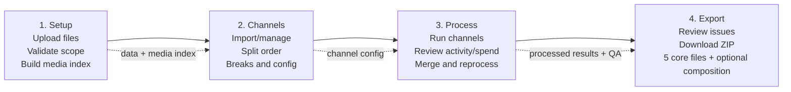
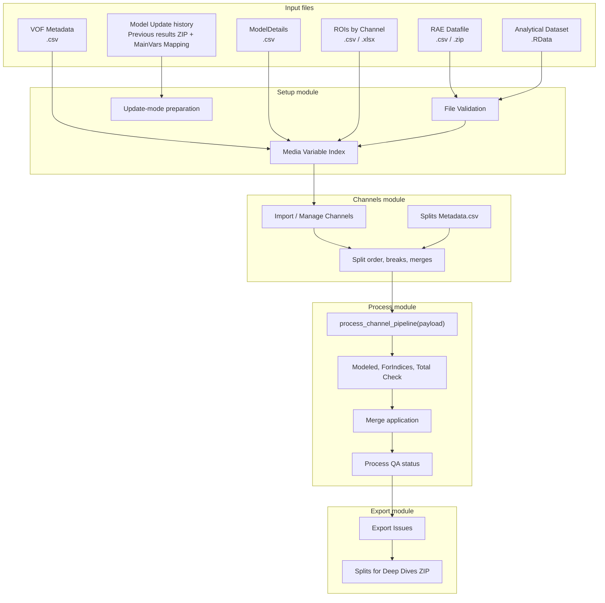
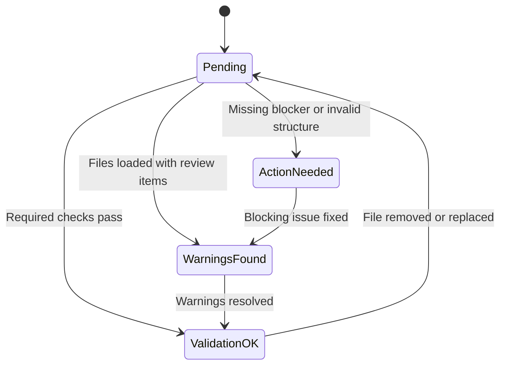
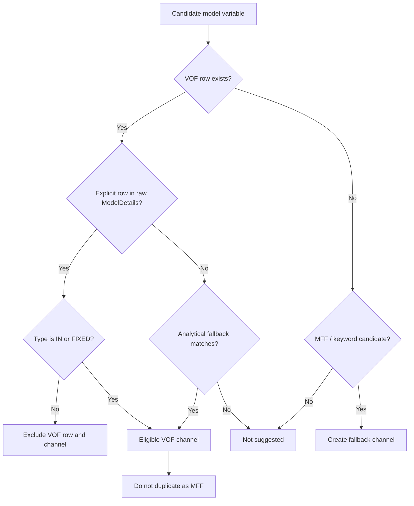
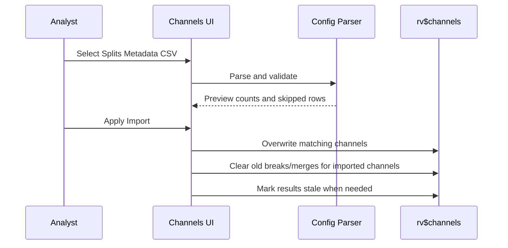
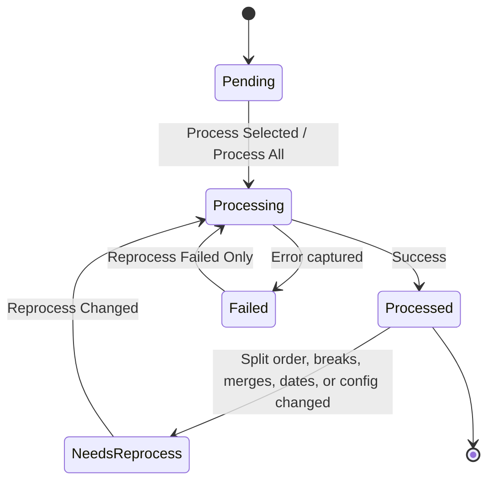
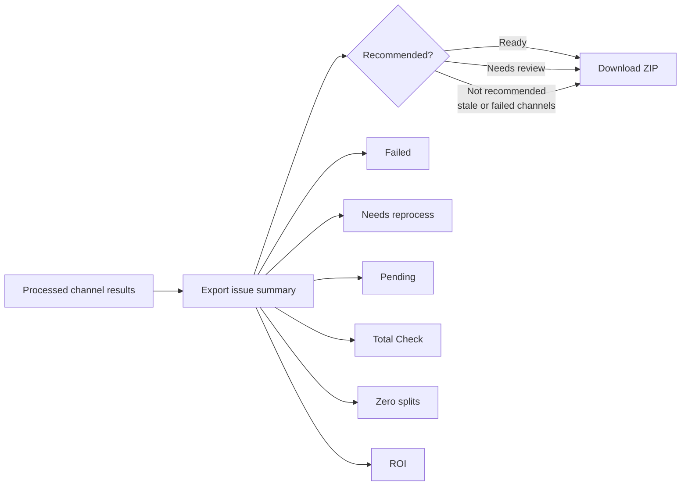
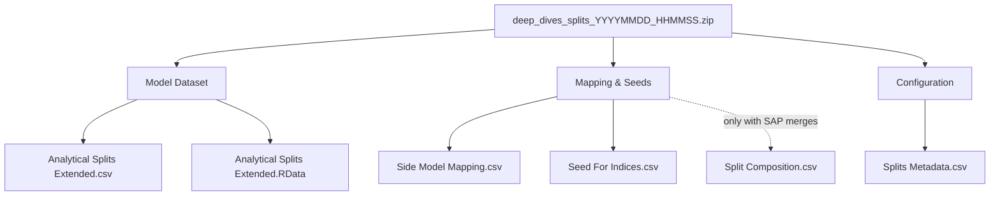
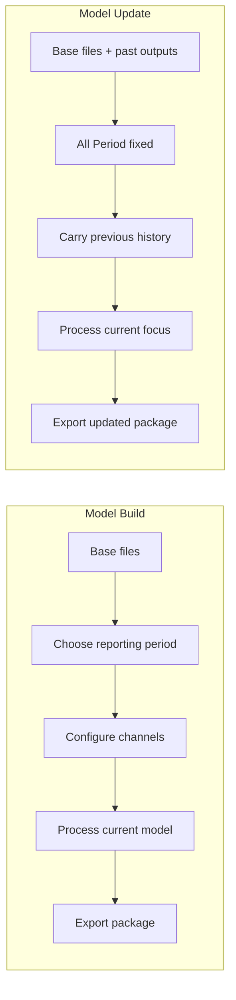

<div align="center">

# Splits Automation Generator App - SAGA

**A Shiny workflow for building, validating, processing, and exporting Splits for Deep Dives.**

Advanced Analytics Colombia / WPP Media

<br>


</div>

---

## Overview

Splits Automation Generator App - SAGA helps analysts transform RAE media data into model-ready Splits for Deep Dives. The app keeps the workflow auditable from upload to export: file validation, VOF/MFF channel detection, split order configuration, dimension breaks, saved merges, processing diagnostics, stale result detection, and final ZIP packaging.

It supports two operating modes:

| Mode | Use it when | Main output behavior |
| --- | --- | --- |
| **Model Build** | Building a new Splits for Deep Dives structure from scratch. | Creates focus and non-focus split columns from the selected reporting period. |
| **Model Update** | Extending a previous model with a new focus period. This workflow is still in development. | Intended to carry past split history forward and append the current RAE Datafile as the new focus period. |

For implementation details, see [application architecture](R/ARCHITECTURE.md),
[contracts](R/contracts/README.md), [services](R/services/README.md),
[controllers](R/controllers/README.md), [views](R/views/README.md),
[utilities](R/utils/README.md), [regression tests](tests/README.md), and
[maintenance scripts](scripts/README.md).

---

## Workflow At A Glance



| Tab | Primary responsibility | Analyst decisions |
| --- | --- | --- |
| **Setup** | Upload files, validate data alignment, build the media variable index. | Build vs Update mode, reporting period, file replacement/removal. |
| **Channels** | Decide which channels are active and how each channel splits. | Add/remove channels, import config, split order, dimension breaks. |
| **Process** | Execute processing and inspect channel outputs. | Process selected/all, merge splits, reprocess failed or changed channels. |
| **Export** | Package the final deliverables. | Review warnings and download the standard ZIP package. |

> [!NOTE]
> Tabs are available during exploratory setup. Missing files and incomplete states are surfaced as inline warnings or blockers inside the relevant tab instead of hiding the rest of the workflow.

---

## Data Flow



---

## Required Inputs

### Base Files

| File | Accepted formats | Required for | Notes |
| --- | --- | --- | --- |
| **RAE Datafile** | `.csv`, `.zip` | Activity and spend source rows. | Formerly called Main Data File. |
| **Analytical Dataset** | `.RData` | Existing analytical model variables and periods. | Used for validation, total checks, and output extension. |
| **VOF Metadata** | `.csv` | Preferred channel auto-configuration. | Provides model variable, analytical variable, dates, geography, effect, and channel metadata. |
| **ModelDetails** | `.csv` | Authority for explicitly listed model variables. | Only `IN` and `FIXED` are active; explicit `NONE` and other non-modeled types cannot be restored by Analytical fallback. |
| **ROIs by Channel** | `.csv`, `.xlsx` | ROI coverage and channel labels. | Optional for exploration, strongly recommended before final export. |

### Model Update Files

| File | Accepted formats | Purpose |
| --- | --- | --- |
| **Previous Results ZIP** | App-generated `.zip` | Analytical Splits Extended, Side Model Mapping, Splits Metadata, and inherited SAP. |
| **Current model files** | Same formats as Model Build | RAE, Analytical, VOF, ModelDetails, and optional ROIs for the new update. |
| **MainVars Mapping** | `.xlsx`, `.xls` | Detects and carries update IDs. |

The previous update ID is inferred from the ZIP and MainVars Mapping when unambiguous. Enter the current update ID and label. Historical columns use `Before <current label>`. Compatible SAP rules are carried forward with their labels updated automatically; references that cannot be matched are reported for review.

> [!TIP]
> In Model Update mode, Reporting Period is fixed to **All Period** because the uploaded RAE Datafile is treated as the current focus period. When returning to Model Build, the previous build-period setting is restored.

---

## Setup

Setup is the intake and validation layer.

### What Setup Handles

| Area | Behavior |
| --- | --- |
| **Batch upload** | The Base Files input accepts multiple files and routes them into the correct file cards when possible. |
| **File cards** | Each card shows loaded state, filename, metadata, source (`manual` or `batch`), timestamp, and remove/reload controls. |
| **Validation** | Compares Analytical vs RAE Datafile for scope, date range, geography/product coverage, and data quality. |
| **Media index** | Builds available channel definitions from RAE Datafile, Analytical, VOF Metadata, ModelDetails, and ROIs when available. |
| **Model Update prep** | Reads previous split outputs and mapping files to prepare update-mode history. |

### Validation States



| Status | Meaning | Analyst action |
| --- | --- | --- |
| `Action needed` | A blocker or missing critical input exists. | Fix upload, structure, or missing required columns. |
| `Warnings found` | Processing can continue, but assumptions should be reviewed. | Read the validation table before proceeding. |
| `Validation OK` | Main alignment checks are clean. | Continue to Channels and Process. |

---

## VOF, MFF, And Channel Detection

The app prefers VOF metadata. MFF / keyword fallback is used only when a
variable is not already covered by an active VOF channel.



### Detection Rules

- VOF rows are matched against ModelDetails using normalized model-variable names.
- Analytical may supply a fallback only when the VOF variable has no explicit
  ModelDetails row. It cannot reactivate a variable marked non-modeled.
- Fallback channels are not created for variables already claimed by VOF.
- The channel manager remains filtered by ModelDetails and excludes rows containing `NONE`.
- Date parsing detects the dominant slash-date format in the VOF vector before parsing ambiguous dates.
- Time-break labels are assigned by unique date ranges, not by duplicate VOF rows.

---

## Channels

Channels is the configuration workspace. It decides which channels are active and how each channel will split.

### Main Controls

| Control | Purpose |
| --- | --- |
| **Splits Metadata download** | Download the current channel configuration from the app-wide toolbar. |
| **Splits Metadata import** | Preview and apply a configuration file from the app-wide toolbar. |
| **Import / Manage Channels** | Add/remove available channels while respecting ModelDetails scope. |
| **Save All Split Orders** | Save all current split order settings. |
| **Search channels** | Filter active channel cards. |

### Channel Card Signals

| Badge | Meaning |
| --- | --- |
| `VOF` | Channel was auto-configured from VOF Metadata. |
| `MFF` | Channel was built from RAE Datafile / fallback logic. |
| `KW` | Keyword fallback detected a usable activity/spend pattern. |
| `Configured` | Split order and model variable are available. |
| `No ROI` | No matching ROI was found yet. |
| `Date limited` | Channel has min/max period restrictions. |
| `Needs reprocess` | A processed channel changed and should be run again. |

### Config Import



Config import is intentionally an overwrite operation for channels present in the config. The imported config becomes the source of truth for split order, dates, breaks, and merges. Channels not present in the CSV are not deleted.

Supported config formats:

- Splits Metadata v3: one `Channel` row per channel, plus `Break`, `Rename`, and one `SAP` row per aggregation component. `RecordType` identifies each row; fields such as `BreakDimension`, `BreakPart1`, `RenameAlias`, `VariableSplit`, and `MergeName` have dedicated columns.
- Previous format using `Type`, `Name`, and `Splits`.
- Legacy format using `BreakInfo`.

### Dimension Breaks

Dimension Breaks split one text dimension into derived dimensions. For example, a campaign string can be broken into multiple named parts such as `Campaign_A`, `Campaign_B`, and `Campaign_C`. Breaks are applied consistently to both activity and spend.

---

## Process

The Process tab runs the channel engine and provides operational diagnostics.



### Actions

| Action | Behavior |
| --- | --- |
| **Process Selected** | Runs only the selected channel. |
| **Process All** | Runs channels that are pending or stale. |
| **Reprocess Failed Only** | Retries only failed channels. |
| **Reprocess Changed** | Runs channels marked `Needs reprocess`. |
| **Splits Metadata download** | Exports current channel configuration from the app-wide toolbar. |

### Diagnostics

| Diagnostic | Purpose |
| --- | --- |
| **Modeled** | Opens first and shows the modeled Activity or Spend/Cost metric, KPIs, and SAP actions. |
| **ForIndices** | Shows the paired metric used for indices when available; it is read-only and follows the modeled period. |
| **Total Check** | Compares processed output against Analytical expectations. |
| **Splits Aggregation Plan (SAP)** | Documents active split aggregations and can be downloaded. |
| **Warnings / Errors** | Captures channel-level failures so the user does not depend only on notifications. |

---

## Export

Export produces the standard Splits for Deep Dives ZIP package. Preflight QA has been removed from the UI; issues are presented only when there is something meaningful to review.



### Export Issues

| Issue | What it means | Recommended action |
| --- | --- | --- |
| **Failed** | One or more channels errored during processing. | Use `Reprocess Failed Only`. |
| **Needs reprocess** | Results are stale after channel configuration changed. | Use `Reprocess Changed`. |
| **Pending** | Active channels have not been processed. | Use `Process All` or `Process Selected`. |
| **Total Check** | Processed totals differ from Analytical expectations. | Review the channel in Process. |
| **Zero splits** | A processed channel produced no split columns. | Check filters, dates, and split order. |
| **ROI** | ROI file is missing or coverage is incomplete. | Upload or correct ROIs by Channel. |

Review warnings do not hard-block ZIP creation. A missing or failed required
output does: the app will not download a partial package.

## Export Package



| File | Description |
| --- | --- |
| `Analytical Splits Extended.csv` | Analytical dataset plus appended split columns. |
| `Analytical Splits Extended.RData` | Same dataset as an RData object for the next update cycle. |
| `Side Model Mapping.csv` | Split-to-model mapping with model weight information. |
| `Seed For Indices.csv` | Activity, spend, ROI, channel, and split-order seed data. |
| `Split Composition.csv` | Optional: component and aggregate lineage when active SAP merges exist. |
| `Splits Metadata.csv` | Reusable channel configuration, including split order, breaks, merges, and dates. |

The ZIP has five core files. Split Composition is omitted when there are no
active SAP merges; if merges are active, its absence blocks the download. No
`qa_report.csv` is generated.

---

## Model Build vs Model Update



### Model Build

Use Model Build when creating a new Splits for Deep Dives structure from scratch.

1. Upload base files.
2. Select Reporting Period: Last 52w, Last 13w, All Period, or Custom.
3. Review File Validation and Media Variable Index.
4. Import/manage channels.
5. Configure split order, breaks, and merges.
6. Process channels.
7. Export the ZIP with five core files and optional Split Composition.

### Model Update

Use Model Update when extending a previous model with a new focus period.
The tab is marked **In development** because the workflow still needs
validation against representative previous results and current model files.

1. Switch Setup to Model Update.
2. Upload base files.
3. Upload the previous results ZIP and MainVars Mapping.
4. Confirm the detected Previous Update ID, then enter Current Update ID and label.
5. Review update processing status.
6. Configure and process the current focus period.
7. Export the updated package after validating the generated results.

---

## Repository Structure

```text
./
|-- global.R                  # Libraries, constants, theme, module sourcing
|-- ui.R                      # Main app shell and navigation
|-- server.R                  # Module wiring
|-- manifest.json             # Posit Connect / Shiny Connect deployment manifest
|-- Description               # Package-style dependency metadata
|-- renv.lock                 # Recorded R package environment
|-- R/
|   |-- mod_setup.R           # Setup tab: uploads, validation, update-mode prep
|   |-- mod_channels.R        # Channels tab: add/remove/config/breaks/import
|   |-- mod_process.R         # Process tab: processing, diagnostics, merges
|   |-- mod_export.R          # Export tab: package preview and ZIP writer
|   |-- contracts/           # Shared list constructors and validators
|   |-- services/            # Data transformations and export builders
|   |-- controllers/         # Shiny observers and renderers by responsibility
|   |-- views/               # Module UI builders
|   |-- utils/
|       |-- functions.R       # Shared data and configuration helpers
|       |-- processing.R      # Core processing helpers and merge application
|       |-- async_processing.R # Worker bootstrap and pure channel pipeline
|-- tests/                   # Executable R regression scripts
|-- .github/workflows/       # Automated R checks
|-- www/
|   |-- styles.css            # WPP visual styling
|   |-- custom.js             # Browser helpers for Shiny inputs/DataTables
|   |-- img/logo.png          # WPP logo
```

`Data Testing/`, local `.RData`, CSV, XLSX, and deployment account files are intentionally excluded from deployment and should not be committed.

---

## Installation

The lockfile targets **R 4.5.2**, Shiny 1.13, promises 1.5 and mirai 2.7.2.
Start from a new R session in the repository root:

```r
install.packages("renv")
renv::restore(prompt = FALSE)
renv::status()
shiny::runApp(".")
```

Restart R after `renv::restore()` so the app uses the restored project library.
Do not run `renv::snapshot()` from another R version because it can rewrite the
versions recorded for deployment.

If only the asynchronous dependencies need repair, run:

```r
renv::install(c(
  "shiny@1.13.0",
  "promises@1.5.0",
  "mirai@2.7.2",
  "nanonext@1.10.2"
))
```

If a full `renv::restore()` cannot complete, install the required application
packages and restart R:

```r
install.packages(c(
  "shiny", "bslib", "DT", "dplyr", "tidyr", "stringr",
  "readr", "purrr", "readxl", "openxlsx", "janitor", "sortable",
  "data.table", "jsonlite", "arrow", "lubridate", "cachem",
  "digest", "zip", "here", "mirai", "nanonext", "promises"
))
```

---

## Deployment To Posit Connect / Shiny Connect

This repository includes a generated `manifest.json` for source-based deployment.

| Field | Value |
| --- | --- |
| Repository | This repository; its existing GitHub slug does not need to change for the app rename. |
| Branch | The branch you want to publish, usually `main`. |
| Primary file | `app.R` (the repository includes a Shiny entry-point wrapper). |
| Auto publish on push | Enable for stable branches; disable while testing heavy changes. |

The manifest must be regenerated after dependency or application changes. It should
use the project R version and `renv.lock` package versions. Generate it from the
repository root with R 4.5.2:

```r
files <- c(
  "app.R", "global.R", "ui.R", "server.R", "Description", "LICENSE",
  list.files("R", recursive = TRUE, full.names = TRUE),
  list.files("www", recursive = TRUE, full.names = TRUE)
)

rsconnect::writeManifest(
  appDir = getwd(),
  appFiles = gsub("\\\\", "/", files),
  appPrimaryDoc = "app.R",
  appMode = "shiny"
)
```

In Posit Connect Cloud, select `app.R` as the primary file. The `manifest.json`
must be committed beside it; Connect Cloud uses this manifest for R and package
versions rather than restoring the project library from `renv`.

---

## Development Notes

Use these checks before pushing larger changes:

```powershell
git diff --check
```

```powershell
Rscript -e "files <- c('global.R','ui.R','server.R', list.files('R', pattern='\\.R$', recursive=TRUE, full.names=TRUE)); for (f in files) { invisible(parse(f)); cat('OK', f, '\n') }"
```

The automated checks in `.github/workflows/r-checks.yml` restore `renv`, parse
the app, and run every `tests/*.R` script. Run the same checks locally before
publishing; browser-level upload-to-export coverage remains a separate task.
Unexpected error details are logged on the server. The UI shows safe summaries
by default. Local debugging options are documented in
[`R/utils/operation_status.R`](R/utils/operation_status.R); keep production
logs access-restricted.

| Area | Manual checks |
| --- | --- |
| Setup | Batch upload, remove/reload cards, missing ROIs, validation table. |
| Channels | VOF import, MFF fallback, config preview/apply, overwrite existing channels, remove/add state. |
| Process | Spend tab, Total Check, failed channels, stale channels, reprocess changed. |
| Export | Warnings, stale/failed/pending states, five core files, optional Split Composition. |

Performance diagnostics can be enabled before starting the app; see
[`R/utils/performance.R`](R/utils/performance.R) for the current option names.

Derived data is cached in memory per session for 30 minutes, with a default
limit of 256 MB. Development runs can override these limits before startup;
see [`R/utils/performance.R`](R/utils/performance.R).

Channel processing uses two global `mirai` workers per R application process.
The worker count, queue budget, and timeout can be configured before startup;
see [`global.R`](global.R) and
[`R/utils/async_processing.R`](R/utils/async_processing.R).

On Posit Connect, these workers are created for every running R process. Include
them when sizing process limits and memory. If worker initialization fails, the
app reports the condition and keeps the existing synchronous processing path.

Verify worker availability with `mirai::status()` in a running app process;
the expected status reports two connections. Always stop and restart the R
process after installing or updating worker dependencies; refreshing the browser
does not restart `mirai` daemons.

---

## Troubleshooting

| Symptom | Likely cause | What to check |
| --- | --- | --- |
| VOF variable appears as MFF | VOF row is not in ModelDetails scope or cannot match Analytical. | Confirm `Type` is not `NONE`, and check `MainModelVariableName` / `AnalyticalVariableName`. |
| Date ranges look wrong | Source file mixes date formats. | Normalize VOF `MinPeriod` and `MaxPeriod`; avoid mixing `MM/DD/YYYY` and `DD/MM/YYYY`. |
| Spend tab is empty | No matching spend rows or keyword mismatch. | Review `spend_keyword` and RAE Datafile variable names. |
| Export reports stale channels | Channel config changed after processing. | Use `Reprocess Changed`. |
| Export reports pending channels | Active channels have not been processed. | Use `Process All` or `Process Selected`. |
| Export reports ROI issues | ROIs file missing or incomplete. | Upload or correct ROIs by Channel before final export. |
| Background workers unavailable | The app process started before `mirai`, `nanonext` or `promises` was restored, or worker bootstrap failed. | Run `renv::restore()`, restart R completely and check `mirai::status()` in the app process. |

---

<div align="center">

**Advanced Analytics Colombia / WPP Media**

Repository owner: `MiguelPalmaWpp`

</div>
